# Introduction

## Research Question

To what extent does Wikipedia's hyperlink network reflect the semantic
relationships between articles about ancient battles?

## Research Objectives

1. Construct a collection of Wikipedia articles concerning ancient battles
   and their historical context.
2. Use Latent Dirichlet Allocation to represent articles as topic
   distributions.
3. Construct a hyperlink network from the collected articles.
4. Calculate semantic and network distances between article pairs.
5. Evaluate the relationship between semantic similarity and network
   proximity.

# Background

The World of antiquity offers a strikingly familiar and alien tone to us in the modern day.  Many of our customs, beliefs, and rituals can find a source back to this period, but at the same time there is only so much that in the modern world that we know about the ancient world.  We have narratives and individuals who jump out at us from this far flung past, but so much of the writings, archealogical evidence and perspectives have been lost to us.  This paper seeks to contextualize the narratives we have about antiquity and serve as building block for future work to analyze the sources of those narratives.  

## Wikipedia as a Knowledge Network

It is for this reason that Wikipedia was chosen as the object of study because it represents a collective story about the past.  With its communitity focus, it allows for a high level synoptic understanding of any particular topic.   This is especially fascinating for the world of Antiquity where knowledge can be concentrated in a select few areas that are influences by centuries of bias about what is considered important. 

## Battles as a Topic

So why Battles?  Battles offer a few features that make them an apt place for the first step on tackling the world of antiquity and our understanding of it.  They for one are tied to a place.  This gives them a connection to the present where those places still exist.  We can go to the sites of these battles from over a millennia ago and see through the eyes of the individual who fought these ancient battles, seeing the same mountains, rivers, and sky.  Battles also offer a strong historical narrative, they are part of wars between states and peoples, which can be influences by ideology and religion.  This allows for the grounded place to transcend to the more abstract quickly and feed directly into the narratives we tell about the past.  It is also helpful as a starting point because much of historical research in the past had a focus on the **Great Men** of history and the **Great Battles** they won.  By anchoring on battles as a topic, we can leverage that past focus even as we try and pull out of that antiquated view of history and move into more technical theories. 

## Topic Modeling and Semantic Similarity

Here is where topic modeling comes in handy. While individual Wikipedia articles tend to focus on a specific subject, they rarely exist in isolation. An article about a battle might discuss the generals involved, the political circumstances leading to the conflict, the geography of the region, or the larger war of which it was a part. Simply comparing article titles or looking for shared words would miss many of these relationships. Topic modeling offers another way to look at the content by identifying recurring themes across the collection of articles.

For this project, I used Latent Dirichlet Allocation (LDA) to identify 15 topics across the 9,015 articles in the collection. LDA works by treating each article as a mixture of topics, with each topic represented by a distribution of words. Rather than assigning an article to one category, the model gives it a probability distribution across all 15 topics. An article about a particular battle, for example, might have a strong association with military history while also containing smaller proportions of topics related to geography, politics, or the individuals involved. 

These topic distributions provide a way to compare the semantic content of different articles. I calculated the KL divergence distance between the topic distributions of article pairs, producing a measure of how different their underlying subject matter is. A lower distance indicates that two articles have more similar topic distributions, while a higher distance indicates greater semantic divergence. This creates a common measure that can be compared against the distance between those same articles in Wikipedia's hyperlink network.

## Network Distance

Topic modeling provides a way to measure how similar two articles are in terms of their content. Wikipedia's hyperlink structure offers another perspective on how they are related. Each article in the collection is treated as a node in a directed network, with links between articles forming the edges. Network distance is measured using the shortest directed path between two articles, representing the minimum number of hyperlinks needed to travel from one article to another. A shorter distance suggests that Wikipedia places the articles closer together within its network of references, while a longer distance suggests a more indirect connection. By comparing these distances with the semantic differences between articles, we can explore whether articles that are closely connected through hyperlinks also tend to cover similar subject matter.

# Literature Review

### Latent Dirichlet Allocation 

This 2003 paper @blei2003latent lays out the application of Latent Dirichlet Allocation(LDA) on machine learning.  In particular, it lays out how a LDA can be used for machine learning to develop a model over a collection of documents. The paper describes the strengths that LDA has over other earlier models like probabilistic LSI (pLSI). This is the foundation of my use of LDA in this project to build out a topic model from the wikipedia corpus that is constructed around the battles of antiquity

### Authoritative Sources in a Hyperlinked Environment 

Kleinberg's 1999 paper @kleinberg1999authoritative examines how hyperlink structures can provide information about the relationships between web pages. It introduces the HITS algorithm, which identifies authoritative pages and the hub pages that connect them within a hyperlink network. Although this research focuses on identifying important pages rather than directly measuring semantic similarity, it establishes the idea that hyperlinks contain meaningful structural information about how topics and information are connected. This provides a theoretical foundation for treating Wikipedia articles as nodes in a directed network and examining the relationships between them through their hyperlinks.

### Wikipedias: Collaborative Web-Based Encyclopedias as Complex Networks

Zlatic and colleagues' 2006 paper @zlatic2006wikipedias examines Wikipedia editions through the framework of complex network analysis. The authors treat Wikipedia articles as nodes and hyperlinks as directed connections, investigating structural properties of the resulting networks. Their work provides a direct precedent for analyzing Wikipedia as a complex network rather than simply as a collection of independent articles. This is particularly relevant to this project because I use the same general approach to construct a directed network of ancient battle articles and their historical context, then examine the shortest paths connecting them.

### Mining Meaning from Wikipedia 

Medelyan and colleagues' 2009 paper @medelyan2009mining reviews the use of Wikipedia as a resource for extracting concepts, relationships, and structured knowledge. The authors discuss how Wikipedia's article content and internal relationships can be used for tasks such as natural language processing, information retrieval, and ontology construction. This is relevant to this research because it supports the idea that Wikipedia contains value beyond its individual article descriptions. Its interconnected content can also be used to study how knowledge is represented and organized. this project builds on this perspective by combining the text of Wikipedia articles with their hyperlink relationships to examine the organization of historical knowledge.

# Data Collection

## Seed Article Selection

The collection of battles was gathered from Wikidata using a SPARQL query. I searched for items classified as battles  with recorded dates between 300 BCE and 500 CE and an associated English Wikipedia article. The date range coincided with a few important historical mile stones running from the Hellenistic Age through the rise and fall of the Seleucid Empire into the Parthian then Sasanian Empire. It captured Rome's rise as a small city state to a mediterranean hegemony.  It includes the latter half of the warring states period in China to the latter stages of the Northern Wei. As such it represented a good mix of starting and ending points of what could be antiquity without favoring any.  The results provided each battle's Wikidata identifier, English name, date, and Wikipedia article URL. Multiple date statements were consolidated, and the resulting collection was exported to CSV. This list served as the starting point for the subsequent Wikipedia article collection and network construction stages.

## Wikipedia Article Collection

After identifying the initial battle articles, I used the Wikipedia API to collect their article text and outgoing hyperlinks. Each battle article served as a seed for the collection, and the crawler followed links outward to discover additional articles.  This was done locally on my machine to save the limited AWS computing budget for the actual LDA process and the network shortest path calculations which proved to be much more computationally intensive. 

This allowed the collection to expand beyond battles themselves to include  people, places, wars, political entities, and other historical subjects. The crawl was configured to reach two link steps beyond the original seed articles, creating a broader picture of the historical context surrounding each battle. However, the crawl ended up only pulling in the complete picture for the first layer of articles from the battles (Depth 1).

The crawler retrieved each article's page ID, title, plain-text extract, and outgoing links. It also recorded the article's crawl depth and, for the original battle articles, preserved the associated Wikidata identifiers, names, and dates. To avoid collecting the same article multiple times, titles were normalized and duplicate pages were checked using their canonical Wikipedia page IDs. The crawler also included retry handling and saved its progress as it ran, allowing the collection to be paused and resumed without starting over.

The resulting collection included both the article text used for topic modeling and the outgoing links used to construct the hyperlink network. Article records were stored in JSONL format, while the extracted link relationships were saved separately in Parquet format. Keeping these two components separate made it possible to analyze the content and network structure independently while maintaining the connections between them. 

Once collected locally these were all deposited into an S3 bucket in AWS.

# Methodology

## Text Preprocessing

Here is where AWS computing and the spark cluster first became involved in the project. I loaded the raw Wikipedia article collection from the previously mentioned S3 bucket and filtered it to include the battle articles and depth 1 linked articles. This produced the primary corpus of 9,015 articles.  

The cleaning process was designed to remove material that was not useful for analyzing the actual content of the articles while preserving the historical text itself. I normalized Unicode characters, standardized whitespace and apostrophes, and removed references, bibliography sections, numeric citation markers, editorial notes such as "citation needed," URLs, and residual HTML tags. When a reference related heading was encountered, the cleaning function removed that heading and everything following it. This was to avoid the later topic model being distracted with reference and bibliographical verbage. 

The cleaned articles were then saved to S3 in Parquet format, retaining each article's page ID, title, crawl depth, cleaned text, and character count statistics. Across the collection, cleaning reduced the total text from approximately 126.3 million to 117.8 million characters, removing about 8.46 million characters about 6.70% of the original text.

### Scalability Note 

As mentioned the decision the collect the articles locally was drive primarly by resource contrants, but the actual text preprocessing was done with Spark through AWS ec2 instances.  This means that as more articles are added to the S3 bucket, this text preprocessing could scale as long as additional ec2 instances were created as workers under thse spark cluster. This will remain true for the following sections and will be repeated.  

## Latent Dirichlet Allocation

I used Latent Dirichlet Allocation (LDA) to identify recurring themes across the 9,015 articles. After tokenizing the text and removing standard English stopwords, I inspected term frequencies to identify additional terms that were not useful for the analysis. I then used Spark's CountVectorizer to create a vocabulary of 20,000 terms, excluding words that appeared in fewer than three articles or in more than 80% of the collection. Each article was converted into a document-term vector representing the frequency of vocabulary terms within it.

I trained the LDA model to identify 15 topics, using 20 iterations of the online optimizer. Rather than assigning each article to a single topic, the model represents it as a probability distribution across all 15 topics. Each topic is itself characterized by words that frequently occur together across the collection. I inspected the highest-weighted terms for each topic to understand the themes the model identified, although these topics were learned from the text rather than defined in advance. 

To build towards the final goal of comparing the topic distance agaisnt the network distance, I applied the trained model to generate a topic distribution for every article.  

### Scalability

Since the LDA process was all done using spark clusters, as additional wikipedia articles are scraped and additional depths are pulled into the corpus then all of the above process can stay the same. although the LDA model would need to stay the same.   The design of breaking the work down by aricle depth (how far away the articles are from the original battle wikipedia articles) was specifically chosen to allow for work to be expanded, but also catagorized differently as it expanded. 

### Topic Similarity Network

After reviewing the individual topics, I wanted to examine how the topics related to one another. This step compares the topics themselves using symmetric Kullback-Leibler (KL) divergence. Each LDA topic can be represented as a probability distribution over the vocabulary, where each word is assigned a probability based on its importance within that topic. Symmetric KL divergence provides a way to measure how different two probability distributions are by combining the divergence in both directions.

Mathematically, the symmetric KL divergence between two topic distributions $P$ and $Q$ is calculated by adding the KL divergence from $P$ to $Q$ and the KL divergence from $Q$ to $P$:

$$
D_{\mathrm{sym}}(P,Q) =
D_{\mathrm{KL}}(P \parallel Q) +
D_{\mathrm{KL}}(Q \parallel P)
$$

Here, $P(w)$ and $Q(w)$ represent the probabilities assigned to a particular word $w$ by two different topics, and $V$ represents the model's vocabulary. A lower symmetric KL divergence indicates that two topics have more similar word distributions, while a higher value indicates greater divergence between them.

## Hyperlink Network Construction

To examine the hyperlink relationships between the collected articles, I constructed a directed network using the Wikipedia links extracted during the collection process. The network consisted of 9,015 nodes, representing the articles in the corpus. Each node retained its Wikipedia page ID, article title, and crawl depth, allowing the original battle articles to be distinguished from the additional articles collected through the crawling process.

I then extracted the outgoing hyperlinks from each article and matched their destinations against the collected article list. This was done by normalizing article titles through lowercase conversion and whitespace trimming before matching the links to the network nodes. Only hyperlinks connecting two articles within the 9,015-article collection were retained. Duplicate connections and self-links were removed, resulting in a directed network where each edge represents a hyperlink from one collected article to another. Because the network is directed, a connection from one article to another does not necessarily mean that the reverse connection also exists. The node and edge tables were  saved to S3 in Parquet format for use in the subsequent network analysis.

## Network Distance Calculation

To measure the structural distance between articles, I calculated the shortest directed path between selected source articles and every article reachable from them in the Wikipedia hyperlink network. Because the network is directed, paths followed outgoing hyperlinks only. The shortest-path distance represents the minimum number of hyperlinks required to travel from one article to another.

I selected a subset of source articles for the analysis because to run across the entire network of 9,015 nodes it would be looking at a potential 81,270,225 pairs of nodes. This subset was all 432 original battle articles (crawl depth 0) and a reproducible random sample of 100 context articles (crawl depth 1). This produced a total of 532 source articles. All 9,015 articles remained available as potential destinations or intermediate nodes along the paths.

The full calculation was implemented using Apache Spark to distribute the processing across the available computing resources. Rather than attempting to calculate every possible path at once, I used an iterative breadth-first search. The process began by assigning each source article a distance of zero from itself. Spark then joined the current set of reachable articles against the network's edge table, following their outgoing hyperlinks to identify the next set of destinations. Each newly discovered destination was assigned a distance one greater than the article from which it was reached.

At each iteration, previously discovered source-destination pairs were excluded from the next set of results. This ensured that each pair was retained only at its shortest discovered distance. Because the search expanded outward one link at a time, the first time a destination was reached represented the shortest directed path from that source. The process continued until no additional reachable articles were discovered. 

To manage the size of the intermediate results, I divided the 532 source articles into 11 batches using a deterministic hash of each article's page ID. This produced batches of approximately 50 sources each. Each batch was processed independently, reducing the amount of source-related work handled in a single run. Intermediate results were written to Amazon S3 in Parquet format at each distance level. This also allowed the process to resume from the last successfully completed level if a batch was interrupted, rather than requiring the entire calculation to restart. The completed batch results were then retained for the subsequent semantic and network distance comparison.

### Scalability
The use of Spark and batch processing was important because the number of source-destination pairs grows as additional source articles are introduced and more of the network becomes reachable. Processing all sources simultaneously would create substantially larger intermediate datasets and increase the memory and computational demands of the calculation.

By dividing the sources into independent batches, the process can be expanded by increasing the number of batches and distributing the work across additional Spark workers. The deterministic source assignment also makes it possible to reproduce the batches and resume incomplete processing. As the article collection expands, the network and edge tables can be updated and the shortest-path calculation repeated using the same general approach. However, adding articles and hyperlinks may change existing shortest paths, so the results would need to be recalculated against the expanded network rather than simply appending new distances to the existing results.

## Semantic Distance Calculation

To compare the semantic relationship between articles, I calculated the symmetric Kullback-Leibler (KL) divergence between their LDA topic distributions. Each article was represented by a probability distribution across the 15 topics identified by the LDA model. Rather than assigning each article to a single topic, this representation captures the relative contribution of all topics to an article.

The comparison was restricted to source-target pairs for which a directed path existed in the hyperlink network. I first removed source-to-self pairs, which had a network distance of zero, leaving only comparisons between distinct articles. I then joined the shortest-path results to the LDA topic distributions for both the source and target articles. This ensured that each comparison contained both the network distance and the semantic information needed to calculate divergence.

Before calculating divergence, I added a small smoothing value of \(10^{-10}\) to each topic probability. This addressed the possibility of zero probabilities, which would otherwise cause problems when calculating logarithms. After adding this value, I normalized each distribution so that the probabilities across the 15 topics summed to one.

I then calculated the symmetric KL divergence between each pair of articles. Unlike standard KL divergence, which measures the difference between two distributions in a particular direction, symmetric KL divergence combines the divergence in both directions. This produces a single measure of how different the two articles' topic distributions are. A value of zero indicates identical topic distributions, while larger values indicate greater semantic divergence between the articles.

The calculations were performed using Apache Spark. For each source-target pair, Spark compared the two topic distributions across all 15 topics and combined the differences into a single symmetric KL value. The resulting dataset retained the source and target article identifiers and titles, the shortest-path distance, and the calculated semantic divergence. I also checked the results for missing divergence values and materially negative values to verify the calculation.

### Scalability

The semantic distance calculation was designed to work with the same distributed approach used for the shortest-path analysis. Rather than collecting the article-pair data and topic distributions into local memory, Spark performed the joins and calculations across the available computing resources. This is particularly important because the number of semantic comparisons depends on the number of reachable source-target pairs produced by the network analysis.

The current analysis calculates semantic divergence for the reachable pairs originating from 532 source articles. Expanding the analysis to use all 9,015 articles as sources would increase the number of potential comparisons to approximately 81.3 million, although the actual number would depend on network reachability. The existing approach could accommodate this expansion by processing the additional pairs through Spark and increasing the available computing resources as needed.

Because the topic distributions are already calculated for all 9,015 articles, expanding the semantic comparison would not require retraining the LDA model, provided the article collection and model remained unchanged. Instead, the additional work would involve joining the expanded shortest-path results to the existing topic distributions and calculating divergence for each pair. As with the network distance calculation, the primary constraints would be processing time, memory, and storage for the larger pair dataset.

## Statistical Comparison

The purpose of this analysis was to examine whether articles that are closer together in the Wikipedia hyperlink network also tend to have more similar LDA topic distributions. I used the shortest directed-path distance as the measure of network proximity and symmetric KL divergence as the measure of semantic difference. Each observation represented a source-target article pair for which a directed path existed and both articles had an LDA topic distribution.

I first grouped the article pairs by their shortest-path distance and calculated descriptive statistics for semantic divergence at each distance. These included the number of article pairs, mean and median symmetric KL divergence, first and third quartiles, standard deviation, and minimum and maximum values. Grouping the results in this way allowed me to examine how semantic divergence was distributed among articles separated by different numbers of hyperlinks.

I also calculated the Pearson correlation coefficient between shortest-path distance and symmetric KL divergence across all article pairs. This provided an overall measure of the direction and strength of the linear association between network distance and semantic divergence. A positive correlation would indicate that greater network distances tend to be associated with greater semantic divergence, while a negative correlation would indicate the opposite. A correlation closer to zero would indicate a weaker linear relationship.

### Scalability

The comparison was performed using Apache Spark, allowing the descriptive statistics and correlation to be calculated across the full collection of reachable source-target pairs without first collecting the individual observations into local memory. As the article collection and number of reachable pairs increase, the same approach can be applied using Spark to distribute the aggregation and correlation calculations across additional computing resources. The distance-level summary is particularly manageable because it reduces the article-pair dataset to a relatively small number of aggregated observations, one for each network distance.

# Results

## LDA

After generating the topic distributions, I calculated several diagnostic measures to better understand how the LDA model represented each article. These included the highest topic probability, the number of topics with a probability of at least 5%, and the entropy of each article's topic distribution. Entropy measures how evenly an article's probability is distributed across the 15 topics, with higher values indicating a more evenly distributed mixture of topics. I also calculated normalized entropy by dividing entropy by the maximum possible entropy, allowing the measure to be interpreted on a scale from 0 to 1. Together, these measures provide a way to examine whether articles are strongly associated with a small number of topics or have broader distributions across the model's topics.

[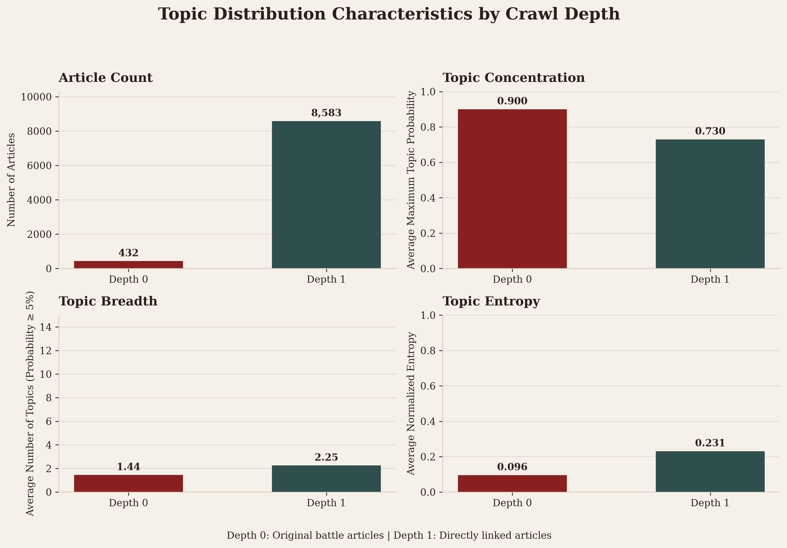](../images/topic_distribution_by_crawl_depth.png){#fig-topic-distribution-depth fig-cap="Average LDA topic distributions by crawl depth."}

An interesting, but largely expected point is that crawl depth 0 has a lower average normalized Entropy  due to those articles being deliberatly chosen on a single topic "battles of antiquity" and so having a low entropy fits that expectation.  Compared to the 8,583 articles which are linked articles off of those 432 battle articles. 

[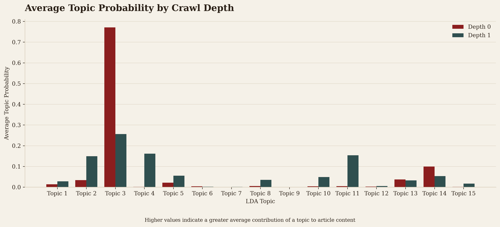](../images/average_topic_probability_by_depth.png){#fig-average-topic-probability-depth fig-cap="Average LDA topic probability by crawl depth."}

The above figure compares the average probability assigned to each of the 15 LDA topics among original battle articles and linked context articles. This provides a more detailed view of how the thematic composition of the two groups differs.  The initial battle list has a much great concentration in a single topic (topic 3) than the depth 1 context articles. 

### Topic Coherence

In addition to reviewing the article-level topic distributions, I evaluated how coherent the topics themselves were using Normalized Pointwise Mutual Information (NPMI). This measure evaluates how frequently the words associated with a topic appear together across the document collection. Higher scores indicate that the words tend to co-occur more frequently than would be expected based on their individual frequencies, suggesting a more coherent topic. Lower or negative scores indicate weaker relationships between the words.

The overall NPMI coherence score across the 15 topics was 0.1822. However, there was considerable variation between individual topics. The highest-scoring topics had coherence values of 0.4370 and 0.4171, while three topics had negative scores. This suggests that while the model identified several groups of closely related terms, the coherence of the resulting topics was not uniform across the collection.

[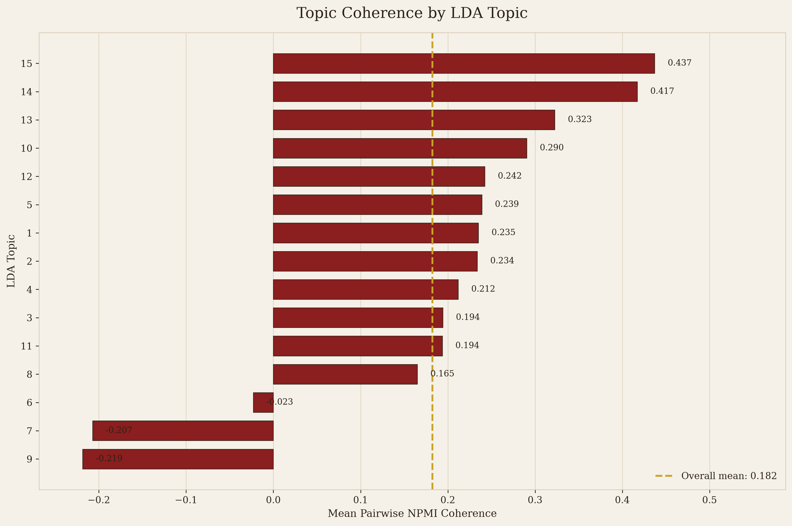](../images/representative_articles/topic_coherence.png){#fig-topic-coherence fig-cap="NPMI coherence scores across the 15 LDA topics."}

#### Selected Topic Top Words

To provide a more concrete look at the topics identified by the LDA model, I examined the highest-weighted words associated with each topic. The following figures show the two topics with the highest NPMI coherence scores and the two with the lowest scores. This provides examples of both the more coherent word groupings and those where the relationships between the top words are less clear. The visualizations for all 15 topics are available in Appendix A.

[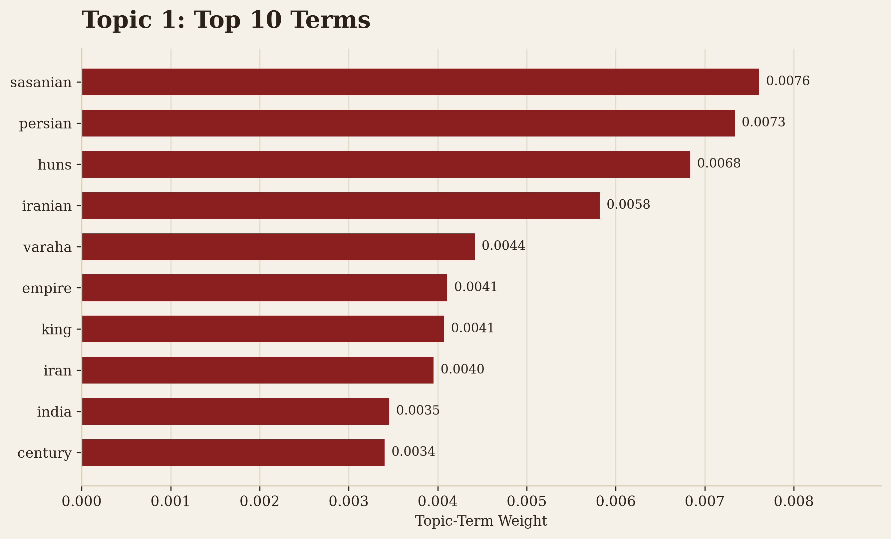](../images/topic_words/topic_01_top_words.png){#fig-topic-0 fig-cap="Highest-weighted words for Topic 0 (highest NPMI coherence)."}

[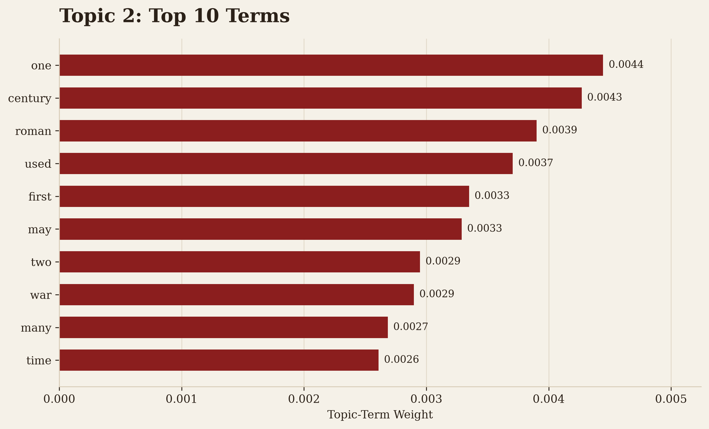](../images/topic_words/topic_02_top_words.png){#fig-topic-1 fig-cap="Highest-weighted words for Topic 1 (second-highest NPMI coherence)."}

[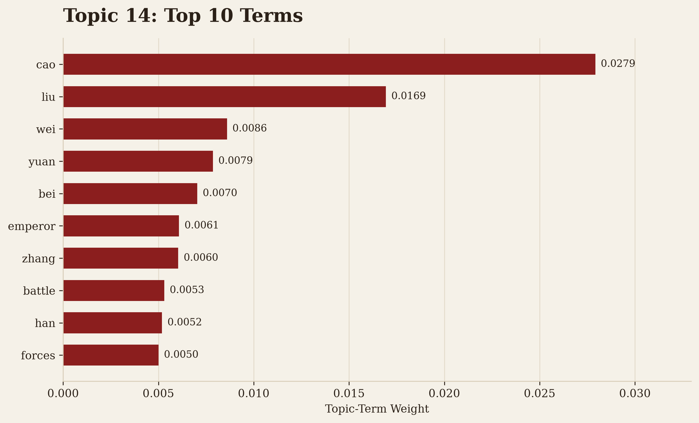](../images/topic_words/topic_14_top_words.png){#fig-topic-13 fig-cap="Highest-weighted words for Topic 13 (second-lowest NPMI coherence)."}

[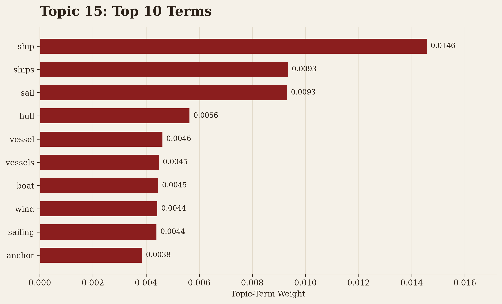](../images/topic_words/topic_15_top_words.png){#fig-topic-14 fig-cap="Highest-weighted words for Topic 14 (lowest NPMI coherence)."}

## Wikipedia Hyperlink Network

The resulting Wikipedia hyperlink network contained 9,015 articles (nodes) and 822,896 directed connections (edges). The network density was 0.01013, meaning that approximately 1.01% of all possible directed connections between articles were present in the network. Of the 9,015 articles, 8,976 had at least one outgoing hyperlink and 8,913 received at least one incoming hyperlink.

To visualize the structure of the network, I selected the 300 articles with the highest total degree, calculated as the sum of each article's incoming and outgoing connections in the full network. I then extracted the hyperlinks connecting these selected articles to one another. The above figure shows the resulting subnetwork, with original battle articles (crawl depth 0) displayed in red and additional context articles (crawl depth 1) displayed in orange. Node selection was based on connections in the full network, while the visualization displays only connections between the 300 selected articles.

[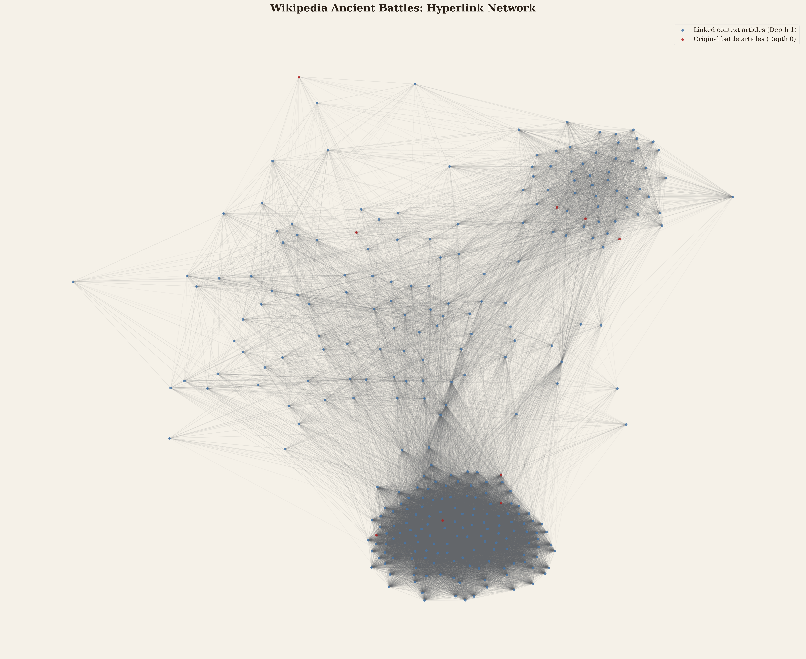](../images/network/wikipedia_network_by_depth.png){#fig-wikipedia-network fig-cap="Subnetwork of the 300 articles with the highest total degree in the full Wikipedia hyperlink network. Red nodes represent original battle articles (depth 0), while orange nodes represent linked context articles (depth 1)."}

### Degree distributions

The degree distributions show the number of articles across different ranges of incoming, outgoing, and total connections. All three distributions are displayed using a logarithmic y-axis to accommodate differences in article counts across degree ranges. This provides an overview of how connections are distributed throughout the network.

[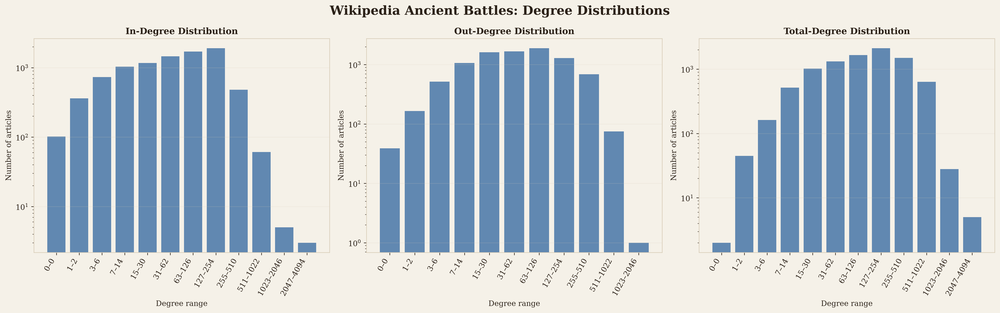](../images/network_diagnostics/degree_distributions.png){fig-cap="Distribution of article degree across the Wikipedia hyperlink network."}

### Incoming vs. outgoing degree

The relationship between in-degree and out-degree provides another perspective on article connectivity. Comparing the two measures shows how the number of links pointing to an article relates to the number of links originating from it.

[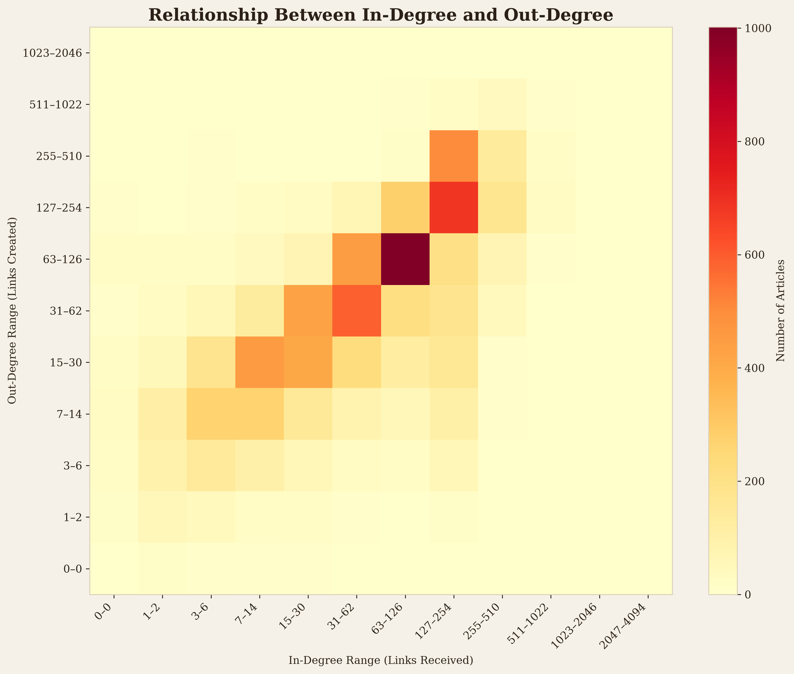](../images/network_diagnostics/in_vs_out_degree_heatmap.png){fig-cap="Comparison of incoming and outgoing connections across network articles."}

### Top 25 Degree articles overall

Focusing on the top rank articles highlight which articles occupy the most connected positions within the Wikipedia collection. The overall ranking identifies the articles with the greatest connectivity across collected corpus

[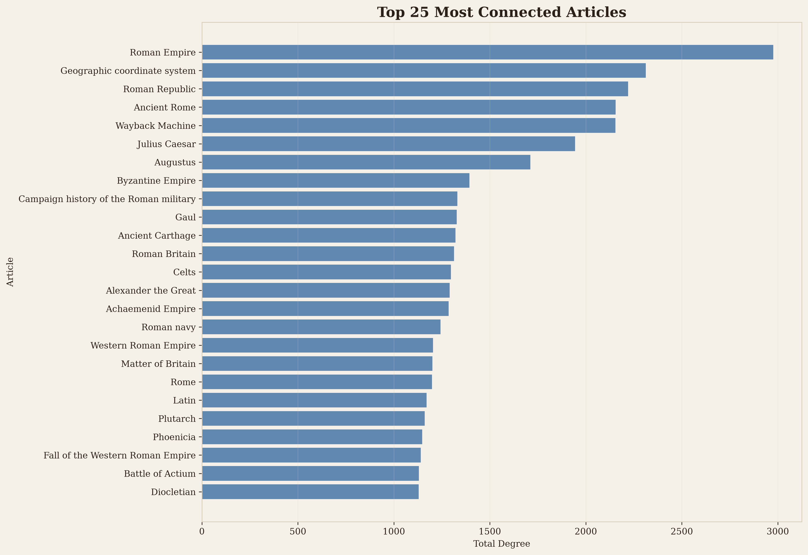](../images/network_diagnostics/overall_top_25.png){fig-cap="The 25 articles with the highest total degree in the full hyperlink network."}

#### Top 25 Degree Battle Articles 

The ranking of original battle articles identifies which battles have the highest total degree within the collected hyperlink network. These articles have the greatest combined number of incoming and outgoing connections among the original battle articles.

[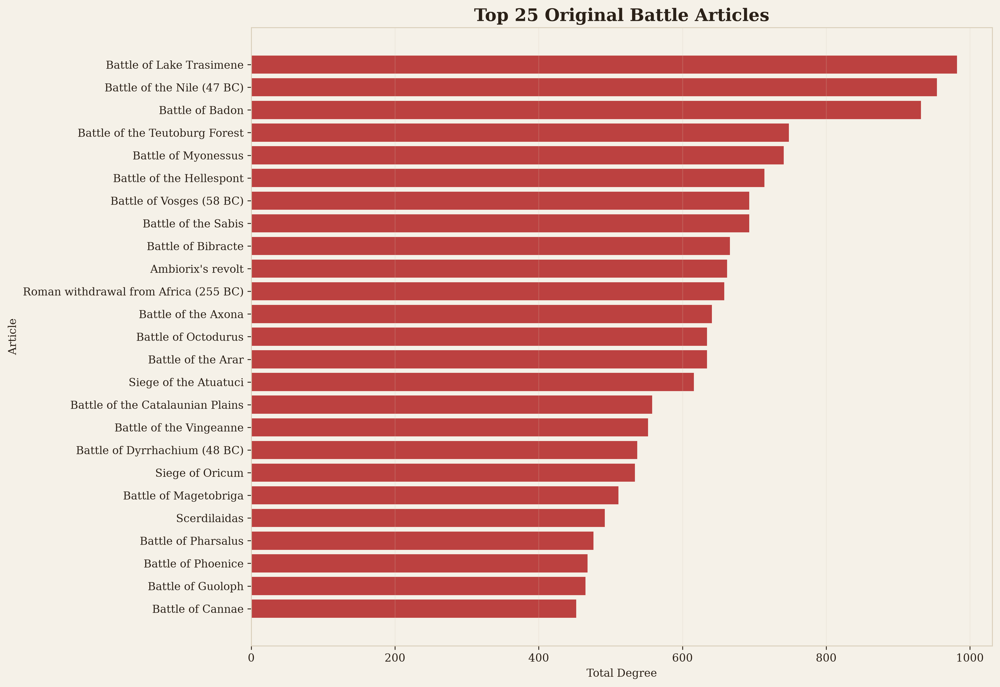](../images/network_diagnostics/battle_articles_top_25.png){#fig-top-25-battles fig-cap="The 25 original battle articles with the highest total degree in the Wikipedia hyperlink network."}

#### Top 25 Degree Context Articles 

The ranking of context articles identifies which linked articles have the highest total degree within the collected hyperlink network. I call them context articles because of how they were scraped then provide context to the original battle articles. These articles represent the most connected historical topics outside the original battle-article collection.

[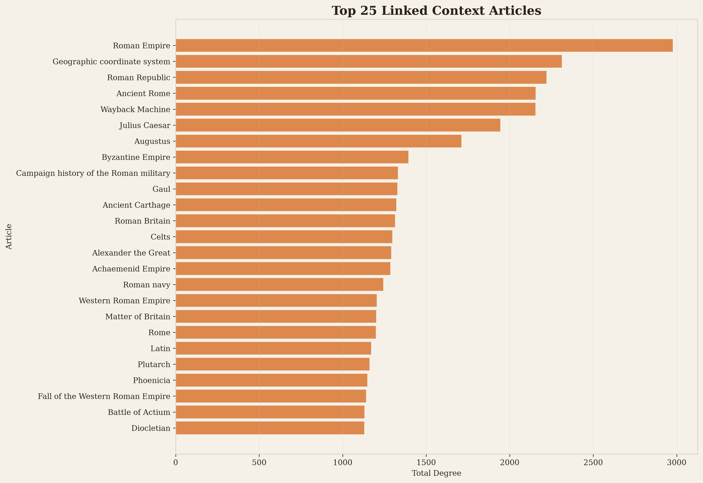](../images/network_diagnostics/context_articles_top_25.png){#fig-top-25-context fig-cap="The 25 linked context articles with the highest total degree in the Wikipedia hyperlink network."}

### Edge mixing matrix

The edge mixing matrix examines how hyperlinks are distributed between the two article groups: original battle articles and linked articles. It distinguishes between links originating from battle articles and those originating from articles, as well as the group to which each link points.

[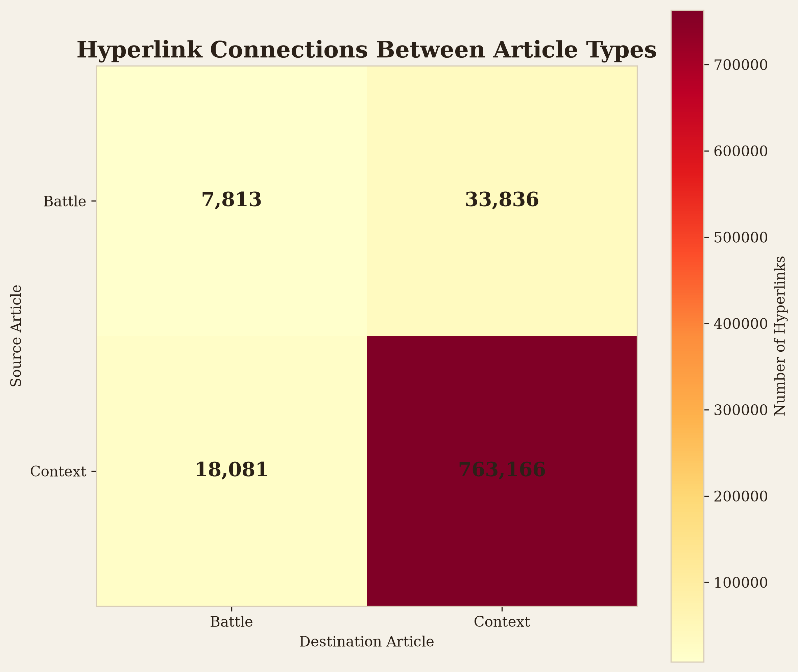](../images/network_diagnostics/edge_mixing_matrix.png){fig-cap="Distribution of directed hyperlinks between original battle articles and linked context articles."}

## Topic Similarity 

The pairwise symmetric KL divergence values for all 15 LDA topics are presented in the below figure. Each cell represents the divergence between a pair of topics, with the numerical values displayed directly in the heatmap. The color scale provides a visual representation of the divergence values, with lighter colors indicating lower divergence and darker colors indicating higher divergence. The matrix includes comparisons between every topic, providing an overview of the semantic differences across the full set of LDA topics.

[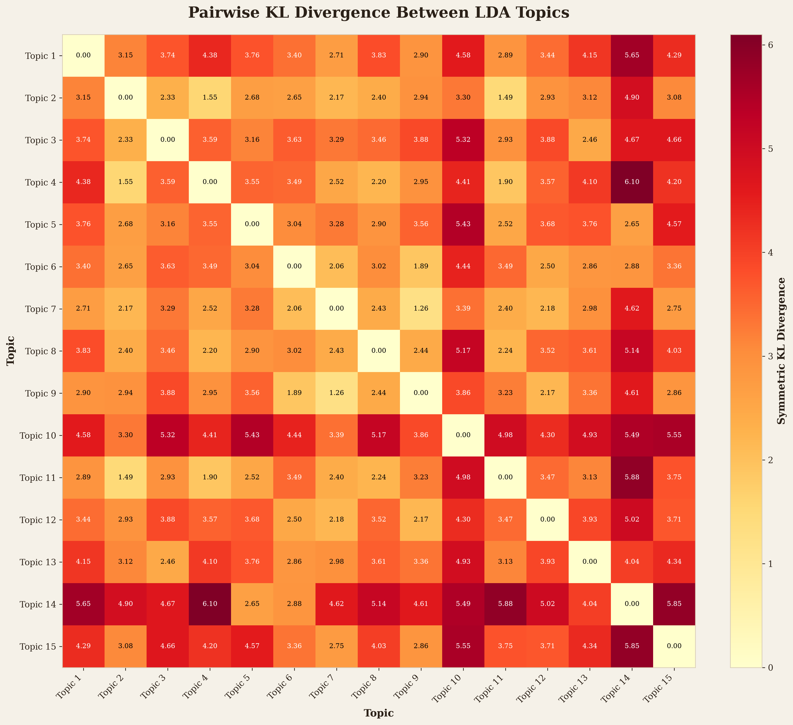](../images/topic_similarity/topic_kl_divergence_heatmap.png){#fig-topic-kl-heatmap fig-cap="Heatmap of pairwise symmetric KL divergence values between all 15 LDA topics. Lower values indicate greater similarity between topic distributions."}

### Network 
The topic similarity network showed the pairwise relationships among the 15 LDA topics, with each topic connected to its two closest neighbors based on KL divergence. The lowest divergence was observed between Topics 7 and 9 (1.2587), followed by Topics 2 and 11 (1.4855) and Topics 2 and 4 (1.5519). The network contained 15 topic nodes and 21 unique connections, with edge thickness representing the relative divergence between connected topics. The figure below presents the resulting network, with the topic labels provided in the legend.

[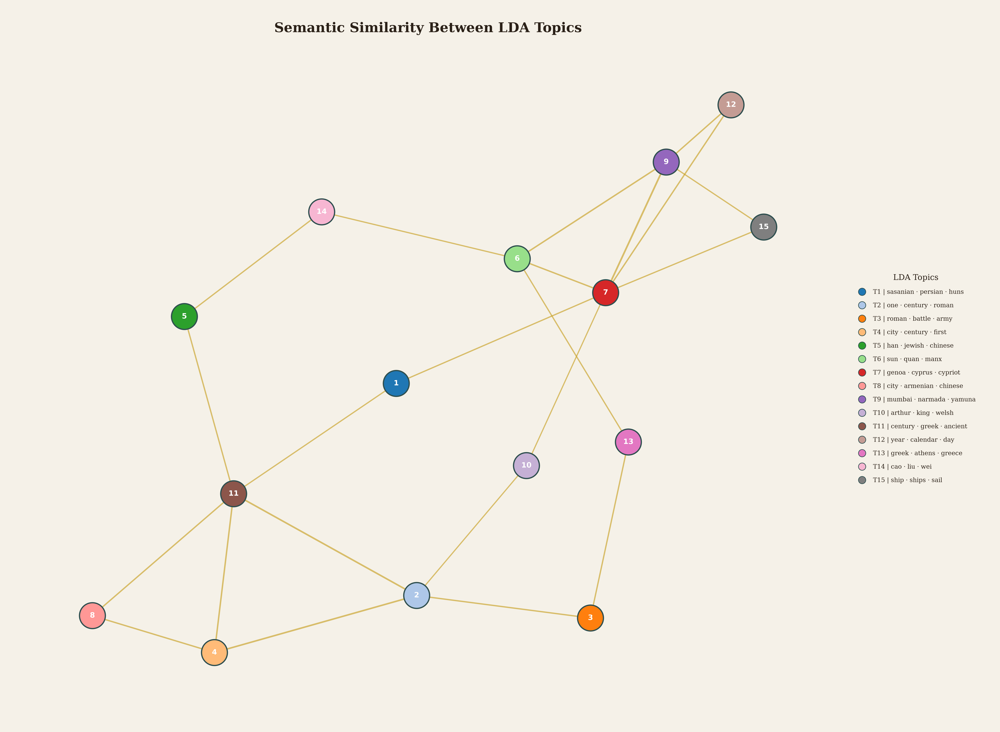](../images/topic_similarity/topic_similarity_network.png){#fig-topic-similarity-network fig-cap="Topic similarity network constructed using the two closest topic neighbors for each LDA topic. Thicker edges indicate lower KL divergence."}

## Semantic and Network Distance Comparison

### Overall Semantic Divergence by Network Distance

The primary comparison examined the relationship between the shortest directed path between two articles and the symmetric KL divergence between their LDA topic distributions. Each observation represents a reachable source-target article pair, with network distance measuring the number of hyperlinks along the shortest directed path and symmetric KL divergence measuring the difference between the two articles' topic distributions.

[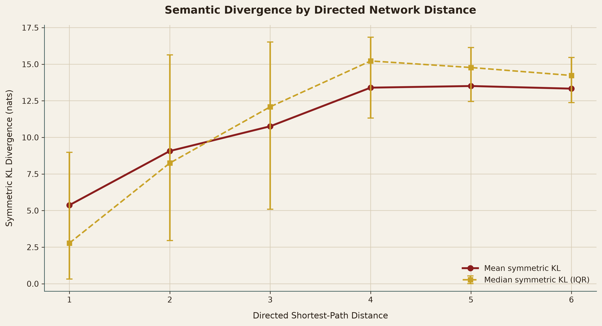](../images/semantic_divergence_by_distance.png){#fig-semantic-divergence-distance fig-cap="Mean and median symmetric KL divergence by shortest directed network distance. Error bars show the interquartile range."}

### Distribution of Semantic Divergence

The distribution of individual article-pair values provides additional detail about the variation within those distances.

[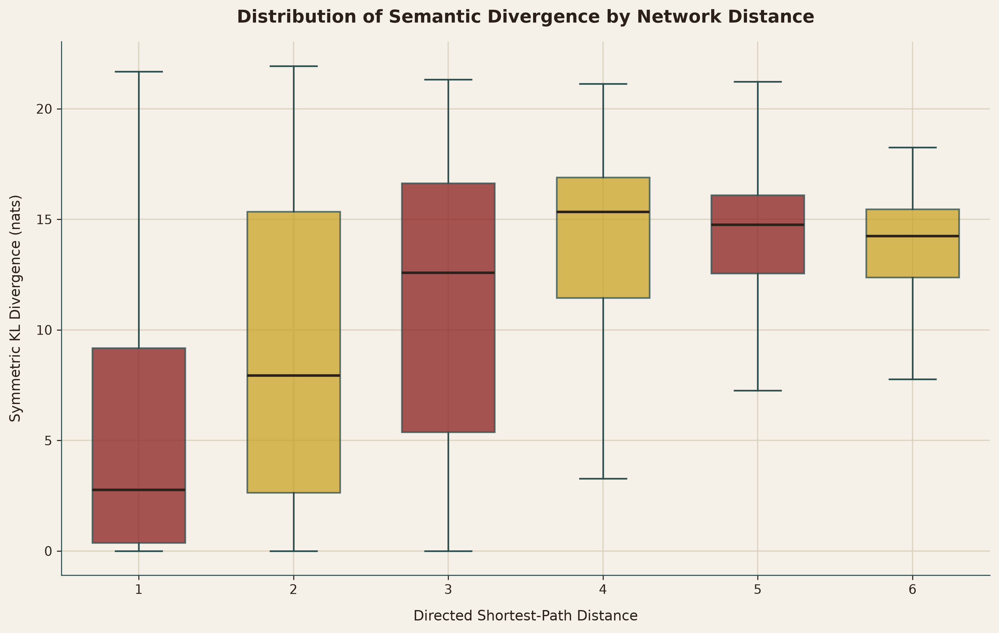](../images/semantic_divergence_boxplot.png){#fig-semantic-divergence-boxplot fig-cap="Distribution of symmetric KL divergence across shortest directed network distances."}

[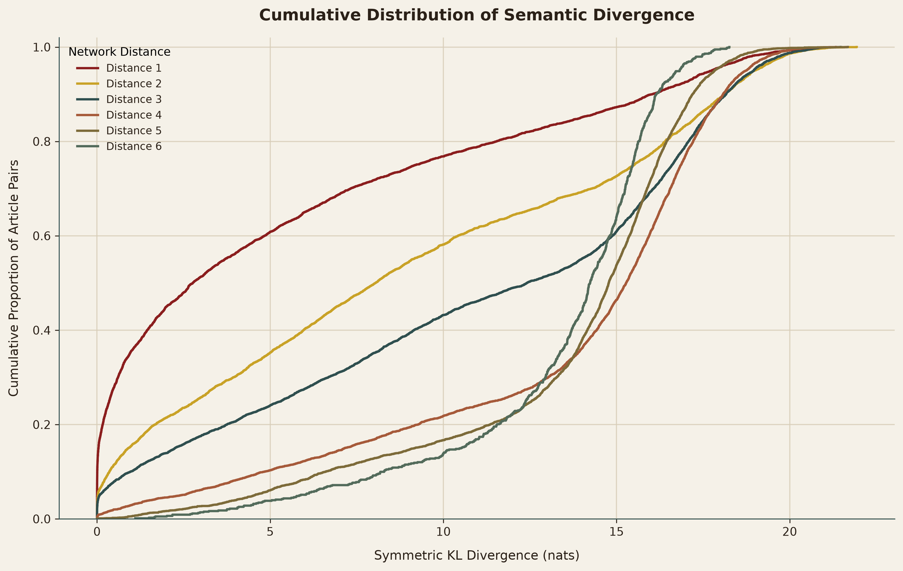](../images/semantic_divergence_ecdf.png){#fig-semantic-divergence-ecdf fig-cap="Empirical cumulative distribution of symmetric KL divergence."}

Above compares the cumulative distributions of symmetric KL divergence across shortest directed network distances. The horizontal axis represents semantic divergence, while the vertical axis shows the cumulative proportion of article pairs with a divergence less than or equal to each value.

The distributions show a noticeable difference between shorter and longer network distances. At distance 1, approximately 60% of article pairs had a symmetric KL divergence of 5 or less. This proportion decreased to approximately 35% at distance 2 and 25% at distance 3. The distributions for distances 4, 5, and 6 were shifted considerably farther to the right, with relatively few article pairs exhibiting similarly low divergence values. This indicates that article pairs separated by fewer hyperlinks generally had more similar LDA topic distributions than those separated by longer paths.

However, the distributions did not follow a consistent progression across all distances. The curves for distances 4, 5, and 6 overlap and cross, indicating that semantic divergence did not increase uniformly with each additional hyperlink. The variation within each distance group also shows that network proximity does not fully determine the semantic relationship between two articles.

### Correlation Between Network Distance and Semantic Divergence

To quantify the overall relationship between network distance and semantic divergence, I calculated the Pearson correlation coefficient across all reachable source-target article pairs. Across 4,729,097 article pairs, the resulting correlation was 0.232, indicating a weak positive linear association between shortest-path distance and symmetric KL divergence. This suggests that articles separated by longer paths in the hyperlink network tend to exhibit greater semantic divergence, although network distance alone does not strongly explain differences in semantic similarity.

### Article-Level Differences

The overall relationship may not be consistent across all source articles. I therefore also examined average semantic divergence by source article and compared source-level divergence with the number of articles reachable from each source.

[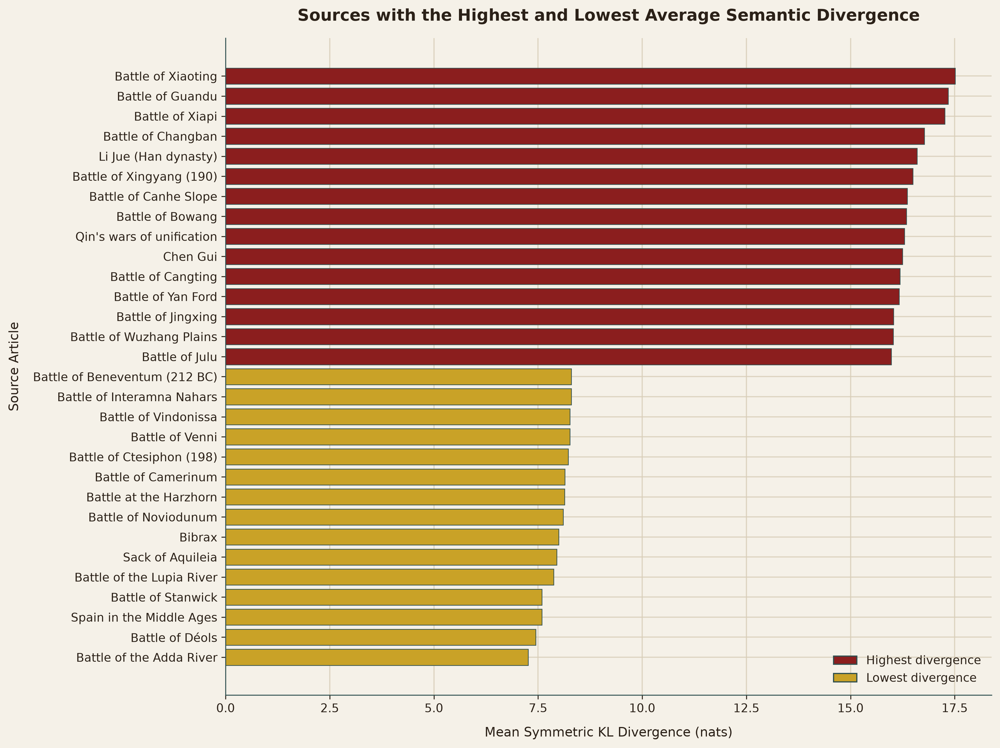](../images/average_divergence_by_source.png){#fig-average-divergence-source fig-cap="Average symmetric KL divergence across reachable target articles for each source article."}

### Examples of Semantic and Network Distance Relationships

[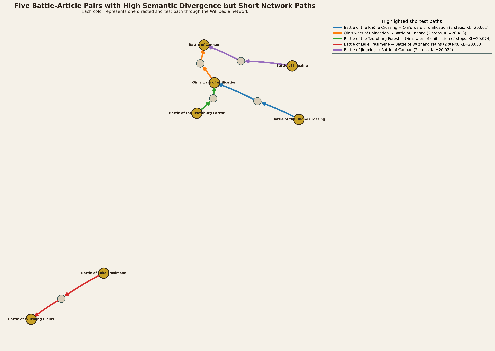](../images/top_5_high_kl_short_network_paths.png){#fig-high-kl-short-paths fig-cap="Five article pairs with high symmetric KL divergence despite having short directed network paths."}

The figure above shows five article pairs with relatively short directed paths but high symmetric KL divergence. Although these articles are connected through only a small number of hyperlinks, their LDA topic distributions are substantially different. The highlighted paths illustrate that close network connections do not necessarily correspond to strong semantic similarity.

[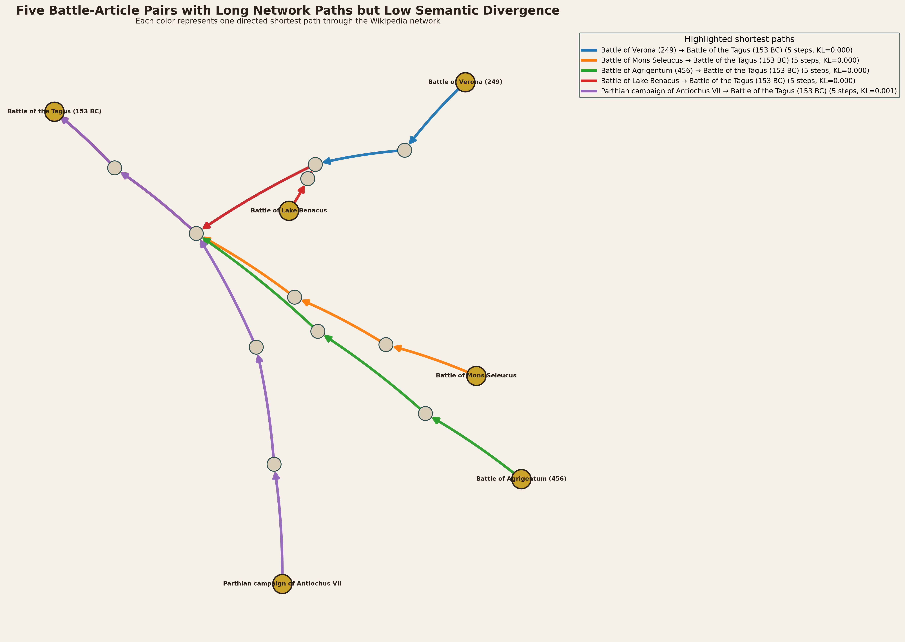](../images/top_5_low_kl_long_network_paths.png){#fig-low-kl-long-paths fig-cap="Five article pairs with low symmetric KL divergence despite having long directed network paths."}

The above figure shows five article pairs with relatively long directed paths but low symmetric KL divergence. Despite requiring several hyperlinks to connect the source and target articles, these pairs have relatively similar LDA topic distributions. This illustrates that articles can be semantically similar even when they are not closely connected in the hyperlink network.

# Conclusion

The above results provide showcase how Wikipedia's hyperlink structure softly reflects the semantic relationships between articles about ancient battles and their historical context.
By comparing article level topic distributions with shortest path distances in the hyperlink network, this study examined whether articles that are more closely connected through hyperlinks also tend to cover more similar subject matter. The primary finding is that semantic divergence loosely increases with shortest path distance in Wikipedia's hyperlink network. This relationship is relatively weak, as the observed correlation of 0.232 suggests that network distance explains only a limited part of the variation in semantic divergence. Articles separated by shorter network paths tend to exhibit more similar topic distributions, while articles separated by longer paths generally demonstrate greater semantic divergence. This suggests that Wikipedia's hyperlink structure captures some degree of the underlying semantic organization of its articles, although the relationship is not uniform across all article pairs.

## Interpretation of Findings

The results demonstrate that Wikipedia's ancient battle articles contain recognizable thematic patterns, while also exhibiting an uneven distribution of structural prominence within the hyperlink network. The LDA model identified 15 topics, 12 of which exhibited positive coherence scores. Several topics also contained collections of words that were readily interpretable in historical and geographic contexts, including themes associated with Iranian and Chinese warfare, as well as naval conflicts. This suggests that the topic model was able to identify meaningful patterns in the corpus, organizing articles around recurring historical subjects rather than producing entirely arbitrary word groupings. However, the presence of three topics with non-positive coherence also illustrates that not every topic was equally interpretable, highlighting the limitations of representing a diverse historical corpus through a fixed number of latent topics.  

The network analysis revealed a notable concentration of Roman related articles among the highly connected context articles (depth 1). Articles concerning Roman history occupied particularly prominent positions across the degree centrality measures, suggesting that Roman related subjects were among the most extensively connected articles in the collected network. This is perhaps unsurprising given that many of the originating battle articles were situated within or around the historical territorial extent of the Roman Empire. The resulting collection of articles therefore contains numerous connections to Roman military, political, geographic, and historical subjects. This illustrates how the the corpus of battles in english language wikipedia from the years 300 bce to 500 ce is heavily tilted towards a roman centric framework.  This emphasis may reflect the greater availability of surviving Roman historical sources, the influence of established Western historical scholarship, or the interests and priorities of Wikipedia's editors and contributors. Although the present analysis does not establish the cause of this imbalance, it highlights the prominence of Rome in the representation of ancient military history within English-language Wikipedia.

Examining the article pairs with the greatest semantic divergence also revealed a potentially interesting geographic pattern. Some of the largest differences occurred between battles associated with Imperial China and those associated with the Roman Empire. This raises the possibility that geographic separation contributes to the semantic differences observed between articles, particularly when comparing historical events from distinct cultural and political regions. However, the present analysis does not directly test this relationship, making geography a potentially valuable additional dimension for future research.

## Limitations

As mentioned through out the paper, scalability was a constant concern, so the above analysis was completed with limited computing power with eventual expansion built into the structure.  Since computing power was limited however, their are some very straight forward limitations to this research

### Article Depth

Wikipedia articles were only scraped at 1 depth away from the battle articles, this meant that the LDA topic model corpus remained relatively focused on the historical context around the battles. This also influenced the shortest path as deeper depths could have potentially created pathways for more connectivity

### Topic Model Representation

The semantic comparisons in this study rely on topic distributions generated through LDA using 15 topics. While the resulting model identified several interpretable themes, this representation necessarily simplifies the underlying content of each article. Articles may share important historical, geographic, or contextual relationships that are not fully reflected in their topic distributions. Similarly, two articles may receive similar topic distributions despite discussing different historical events. With additional computing resources, future iterations of this analysis could explore models with a larger number of topics to determine whether more granular thematic distinctions improve the representation of the corpus.

Relatedly, the selection of 15 topics was not determined through a systematic optimization process based on topic coherence. Instead, this number was selected with consideration for the intended level of thematic granularity and approaches used in related research. Although the resulting model produced several interpretable topics, a more systematic evaluation of different topic counts could provide a stronger basis for model selection. Future work could evaluate models across a range of topic counts using coherence metrics, alongside qualitative assessments of topic interpretability, to identify a configuration that better balances thematic specificity and coherence.

### Shortest Paths and KL Divergence

Due to computation constrants, rather than calculating shortest paths from all 9,015 articles, I used all 432 original battle articles and a reproducible random sample of 100 depth 1 context articles as sources. All 9,015 articles remained available as potential destinations and intermediate nodess. The project was designed in such a way however that as more computing power is added a larger number of samples could be selected or potentially the full set of article pairs could be calculated.

## Future Work 

There are many areas that would compliment and build off of this analysis.  As mentioned earlier, bringing in a geospatial component as an additional distance measure, so that not only are the battle articles compared based on their network distance and semantic difference, but also there physical difference.  This would allow for insight into if certain geographical areas are more prominent in Wikipedias hyperlink network related to the battles of antiquity.  It would also highlight potential connections for how certain areas of the world are presented compared to others when thinking about the semantic layer. 

However, the most obvious additional work would be expanding the corpus of wikipedia articles in the network. the structure of this research was explicitly designed with this in mind, so that additional depths of articles could be scrapped and pulled into the network.  Then it could be further analysised by the cluster to rerun the LDA topic model and all futher analysis such as the shortest path distances and semetric KL divergences calculated between articles.   

Finally, the corpus could be expanded beyond the historical period examined in this study. Incorporating battles from earlier or more recent periods would allow for comparisons of how military history is represented across different historical eras. In particular, including more modern conflicts could provide insight into how increased historical documentation and the availability of contemporary sources influence the thematic and network structures of Wikipedia articles. This would extend the analysis beyond the representation of ancient history and provide a broader perspective on how historical knowledge is organized within the wikipedia.

# References

::: {#refs}
:::

# Appendix A: Complete LDA Topic Visualizations

The following figures present the highest-weighted words associated with each of the 15 topics identified by the LDA model. Together, they provide a complete view of the topics discussed in the main analysis.

{fig-cap="Highest-weighted words for Topic 0."}

{fig-cap="Highest-weighted words for Topic 1."}

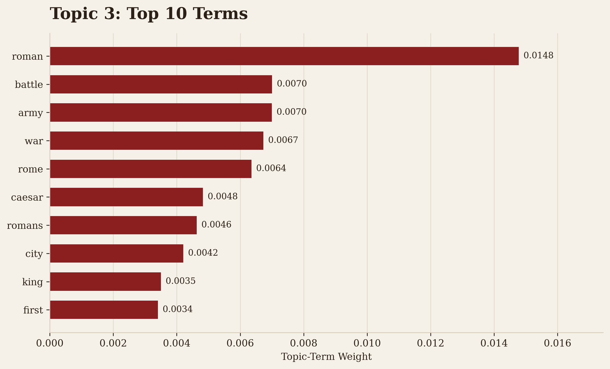{fig-cap="Highest-weighted words for Topic 2."}

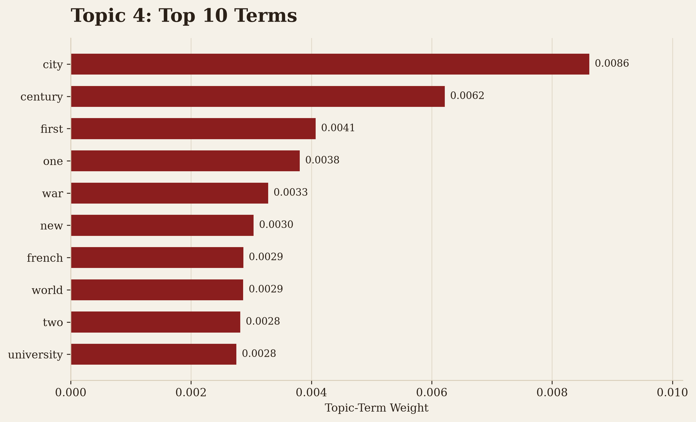{fig-cap="Highest-weighted words for Topic 3."}

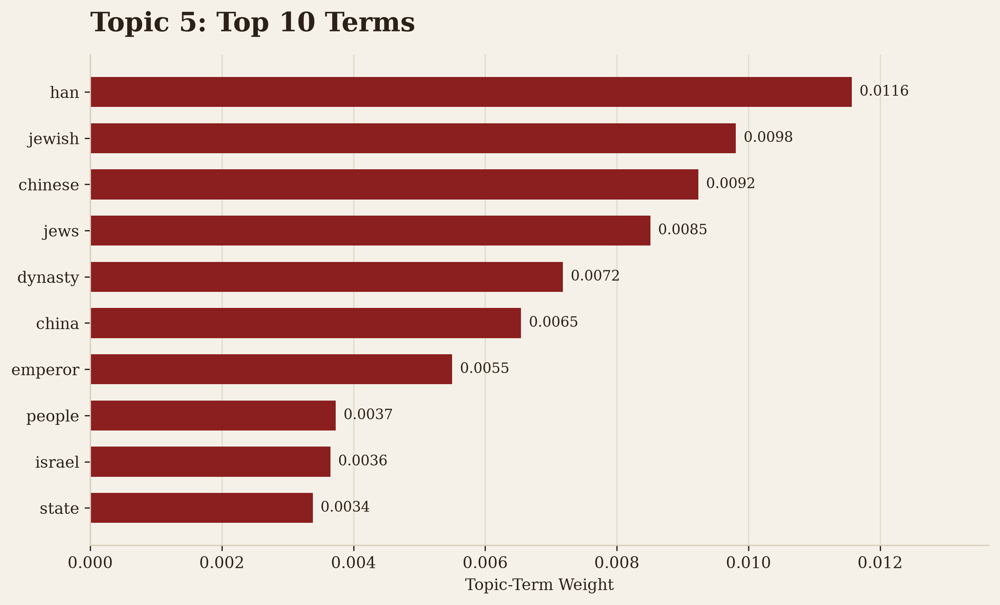{fig-cap="Highest-weighted words for Topic 4."}

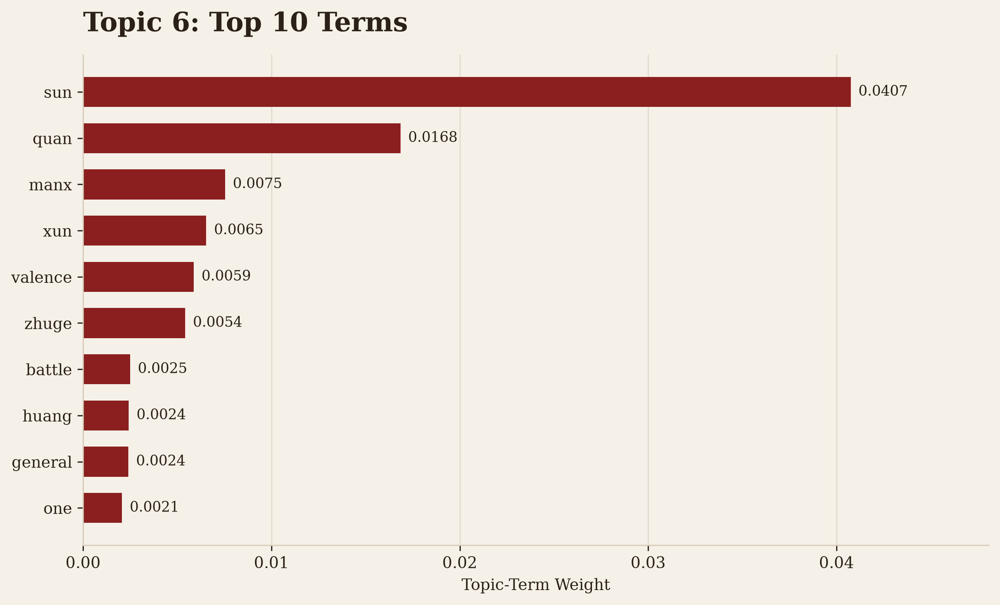{fig-cap="Highest-weighted words for Topic 5."}

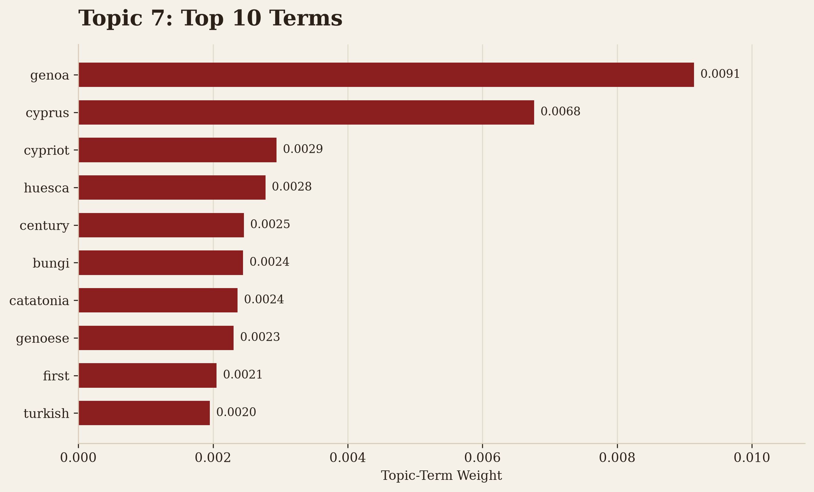{fig-cap="Highest-weighted words for Topic 6."}

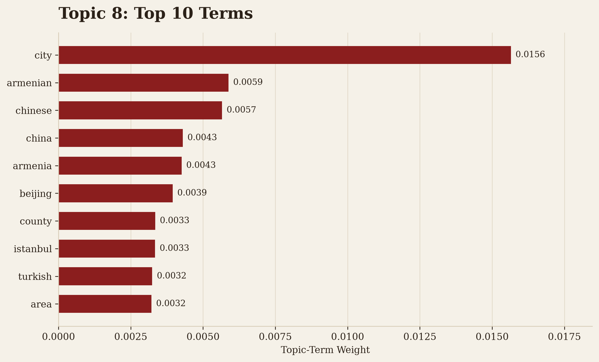{fig-cap="Highest-weighted words for Topic 7."}

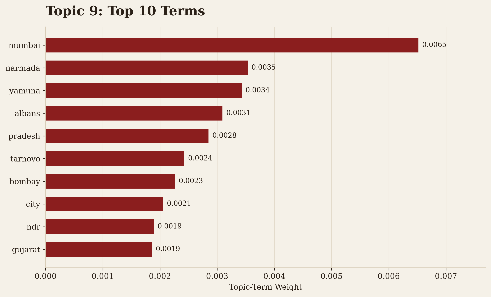{fig-cap="Highest-weighted words for Topic 8."}

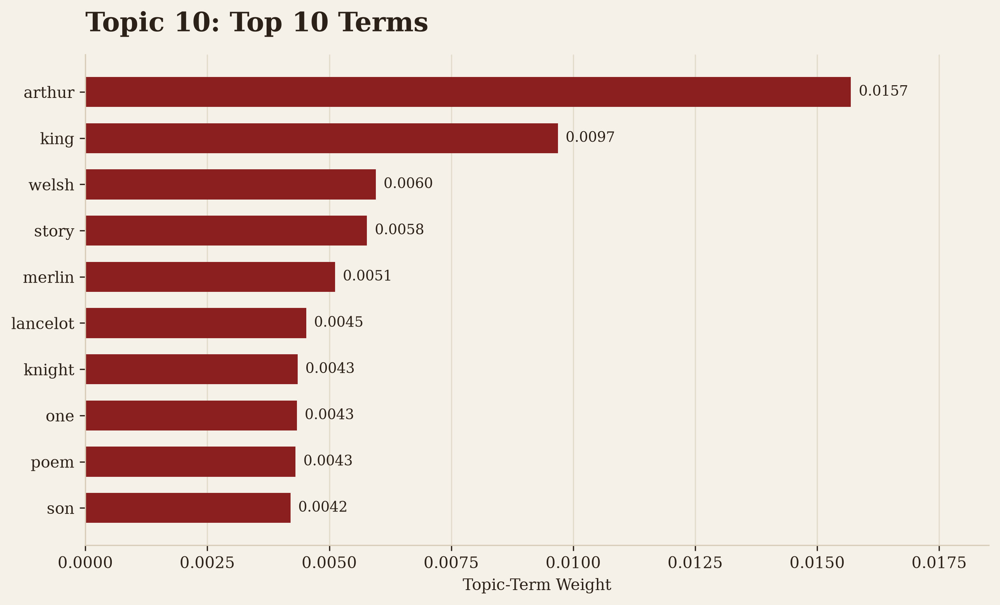{fig-cap="Highest-weighted words for Topic 9."}

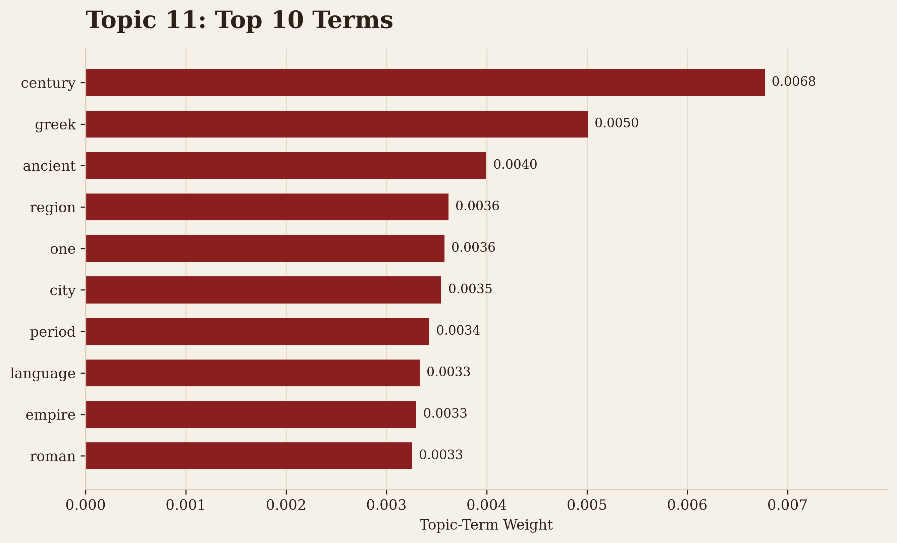{fig-cap="Highest-weighted words for Topic 10."}

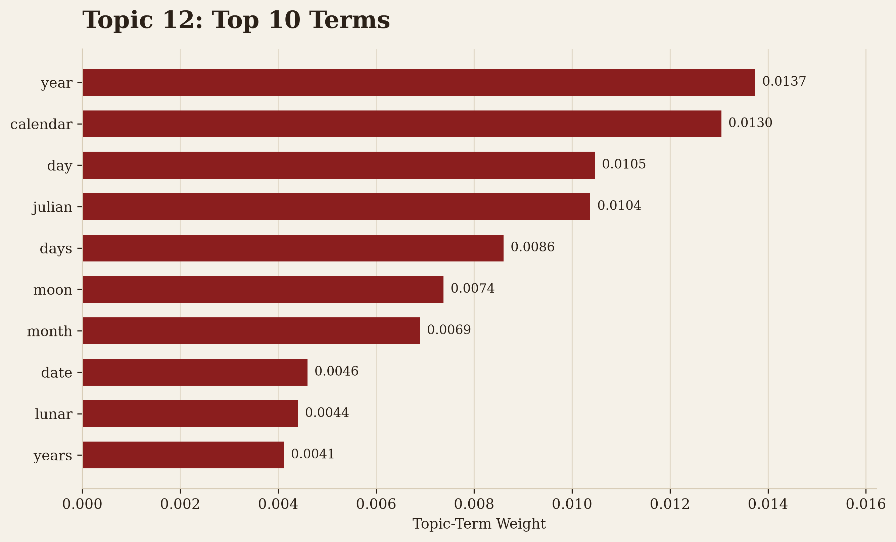{fig-cap="Highest-weighted words for Topic 11."}

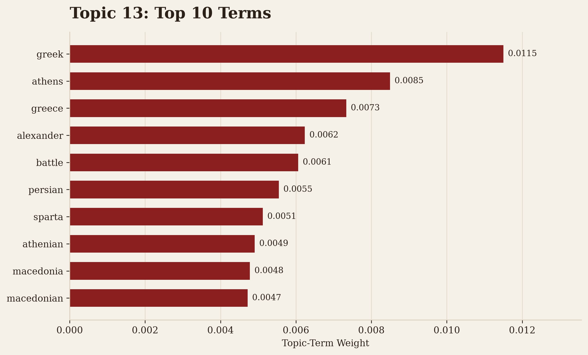{fig-cap="Highest-weighted words for Topic 12."}

{fig-cap="Highest-weighted words for Topic 13."}

{fig-cap="Highest-weighted words for Topic 14."}